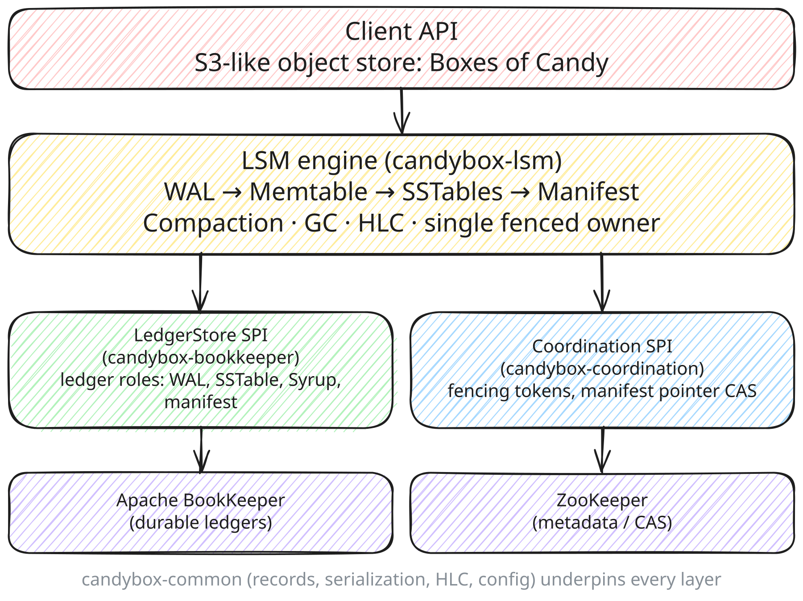
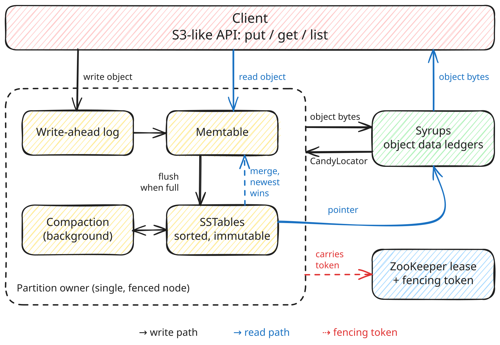

<div align="center">
    
    <h1>Candybox</h1>
    <h3><em>A self-hosted, distributed object store with a sorted LSM-tree index on Apache BookKeeper</em></h3>
</div>

<p align="center">
    <i>Listing, Prefix Search, and Directory-walk workloads are sequential range scans,<br>with durability delegated to BookKeeper.</i>
</p>

<p align="center">
  <a href="https://predatorray.github.io/candybox/"></a>
  <a href="https://javadoc.io/doc/me.predatorray.candybox/candybox-client"></a>
  <a href="https://hub.docker.com/r/zetaplusae/candybox"></a>
  <a href="https://github.com/predatorray/candybox/releases"></a>
  <a href="https://github.com/predatorray/candybox/blob/main/LICENSE"></a>
  <br>
  <a href="https://github.com/predatorray/candybox/actions/workflows/ci.yml"></a>
  <a href="https://github.com/predatorray/candybox/actions/workflows/docker-publish.yml"></a>
  <a href="https://codecov.io/github/predatorray/candybox" ></a>
  <a href="compat/s3-tests/README.md"></a>
</p>

---

Candybox is a **distributed, S3-like object store** written in Java. You create buckets and store
objects through a small TCP API, an S3-compatible HTTP gateway, or a command-line client, and Candybox
keeps them durable and replicated across a cluster.

Under the hood it is a **distributed LSM tree built on [Apache BookKeeper](https://bookkeeper.apache.org/)**.
Object data and the index live in BookKeeper's replicated, append-only ledgers. A single fenced owner
per bucket partition keeps reads and writes consistent during failover, and partitions are spread
evenly across the cluster.

> **Vocabulary**
>
> A **Box** is a bucket, <br>
> a **Candy** is an object, <br>
> a **CandyKey** is an object key, <br>
> and a **Syrup** is a data ledger that holds object bytes. <br>
> <i>(Candy in a box — that's the whole theme.)</i>

## Quick start

### With Docker Compose (recommended)

The bundled [`docker-compose.yml`](docker-compose.yml) starts ZooKeeper, 3 BookKeeper bookies, 3
Candybox nodes and the S3 gateway (on `:9711`) from the
[`zetaplusae/candybox`](https://hub.docker.com/r/zetaplusae/candybox) image:

```bash
docker compose up -d
docker compose run --rm cli create-box photos
echo 'hello candybox' | docker compose run --rm -T cli put photos hello.txt
docker compose run --rm cli get photos hello.txt   # -> hello candybox
```

Tear it down with `docker compose down` (add `-v` to also wipe the data volumes). The
[quick start guide](https://www.predatorray.me/candybox/docs/getting-started/quickstart/) walks through this in more detail.

### Download and Maven Central

Release **0.1.0** is out. The distribution archive is attached to the
[GitHub Release](https://github.com/predatorray/candybox/releases/tag/v0.1.0), and the Java client is on
Maven Central:

```xml
<dependency>
  <groupId>me.predatorray.candybox</groupId>
  <artifactId>candybox-client</artifactId>
  <version>0.1.0</version>
</dependency>
```

See [Installation](https://www.predatorray.me/candybox/docs/installation/) for all options.

### Web dashboard

The compose stack also starts a stateless admin service with a dashboard at
[`http://localhost:9713/ui/`](http://localhost:9713/ui/). It shows cluster topology, a box browser,
LSM internals and time-series charts. The same process serves a JSON API under `/api/*`; see
[Operations](https://www.predatorray.me/candybox/docs/operations/#admin--dashboard-api). To build the dashboard into the jar, add
`-Pfrontend` to the Maven build.

### S3 compatibility

The gateway is tested against the [`ceph/s3-tests`](https://github.com/ceph/s3-tests) suite. With
SigV4 auth and ACLs enabled, 192 of 838 boto3 functional tests pass. Versioning, SSE, POST object,
lifecycle, bucket policy, CORS and conditional GET are not implemented yet. The per-family breakdown
is in [`compat/s3-tests/README.md`](compat/s3-tests/README.md#latest-calibration), and the
[S3 gateway docs](https://www.predatorray.me/candybox/docs/s3-gateway/) cover usage, range GET and multipart upload.

## Storing and retrieving objects

The `zetaplusae/candybox` image doubles as the command-line client: `candybox <args>` runs the CLI
instead of a storage node. Point it at a node with `CANDYBOX_SERVER` (or `-s host:port`):

```bash
alias candybox='docker run --rm -i --network candybox_default \
  -e CANDYBOX_SERVER=candybox-1:9709 -v "$PWD:/data" -w /data zetaplusae/candybox candybox'

candybox create-box photos
candybox put  photos cat.jpg cat.jpg --content-type image/jpeg
candybox get  photos cat.jpg out.jpg
candybox head photos cat.jpg            # size, content-type, checksum, metadata
candybox list photos                    # keys in the box
candybox help                           # full command list
```

From Java, use `CandyboxClient` in the `candybox-client` module. The
[command-line client docs](https://www.predatorray.me/candybox/docs/client/) list every command.

### Operations the sorted LSM tree makes cheap

Keys are stored sorted and object bytes sit behind small pointers, so a few operations that are
expensive in other S3-style stores are cheap here:

```bash
candybox list   photos --start a --end m --reverse   # bounded, reverse-order range scan
candybox copy   photos cat.jpg cat-copy.jpg          # zero-copy: shares the stored bytes
candybox rename photos cat.jpg pets/cat.jpg          # zero-copy move
candybox delete-range photos thumbnails/             # one range tombstone, not N deletes
```

- **Range scans** walk a `[start, end)` window in either direction.
- **`copy` and `rename`** point a new key at the same stored bytes, even across partitions. A
  same-partition `rename` is atomic; a cross-partition one is eventually atomic, so a reader may
  briefly see both keys.
- **`delete-range`** removes a prefix or key window with a single tombstone, and compaction reclaims
  the bytes later.

## Configuration

The node reads `conf/candybox.properties`. Any key can be overridden by an environment variable named
`CANDYBOX_<KEY>` (dots become underscores, upper-cased), such as `CANDYBOX_ZOOKEEPER_CONNECT`; the
environment value wins. The most common keys:

| Key | Meaning | Default |
|---|---|---|
| `node.id` | Cluster-unique node id. Falls back to the trailing number in `$HOSTNAME`. | — |
| `zookeeper.connect` | ZooKeeper connect string. | `127.0.0.1:2181` |
| `server.bind` | Address clients connect to. | `0.0.0.0:9709` |
| `server.advertised` | Address published to the cluster for routing. | bind address |
| `health.port` | HTTP port for `/healthz` (liveness), `/readyz` (503 while ZooKeeper is unreachable), `/metrics`. | `9710` |

The full list is in the [configuration reference](https://www.predatorray.me/candybox/docs/reference/configuration/).

## Running on Kubernetes

The root `Dockerfile` builds a node image from source (`docker build -t candybox:latest .`). A
`StatefulSet` and headless `Service` manifest is in `examples/kubernetes/`; `node.id` and the
advertised address are derived from the pod name. See [Operations](https://www.predatorray.me/candybox/docs/operations/#running-on-kubernetes)
for details.

## Architecture

Candybox is layered: an S3-like object API sits on a per-Box LSM engine, which talks to two narrow
SPIs, which run on Apache BookKeeper (durable ledgers) and ZooKeeper (coordination and metadata).



### How it works



- **LevelDB-style LSM tree for the index.** Writes go to a memtable behind a write-ahead log, are
  flushed to immutable sorted SSTables, and are merged by background compaction. Reads merge the
  memtable and SSTables, newest wins.
- **Object bytes stay out of the tree.** They are written to Syrups, and the tree stores only a small
  pointer to each object, so compaction stays cheap however large the objects are.
- **BookKeeper ledgers as the durable medium.** SSTables, WALs, manifests and Syrups are all
  append-only replicated ledgers. Data is never mutated in place; updates and deletes are new appends.

Consistency rests on single, fenced ownership per partition. Each Box is split into a fixed number of
hash partitions, and exactly one node owns a partition at a time, under a ZooKeeper lease with a
fencing token that every state-changing operation carries. A stale former owner therefore cannot
corrupt the partition after a failover. An elected balancer spreads ownership across nodes, and writes
are stamped with a hybrid logical clock for last-writer-wins ordering.

Record formats and the fencing and handover protocol are in [`DESIGN.md`](DESIGN.md); see also the
[architecture docs](https://www.predatorray.me/candybox/docs/architecture/) and [`BOX_PARTITIONING_PLAN.md`](BOX_PARTITIONING_PLAN.md).

## Building from source

Requires **Java 17+** and **Maven 3.9+**. Nothing else is needed; the integration tests run an
in-JVM BookKeeper and ZooKeeper.

```bash
mvn -q -DskipTests package   # build everything, including the distribution archive
mvn verify                   # unit and integration tests
```
