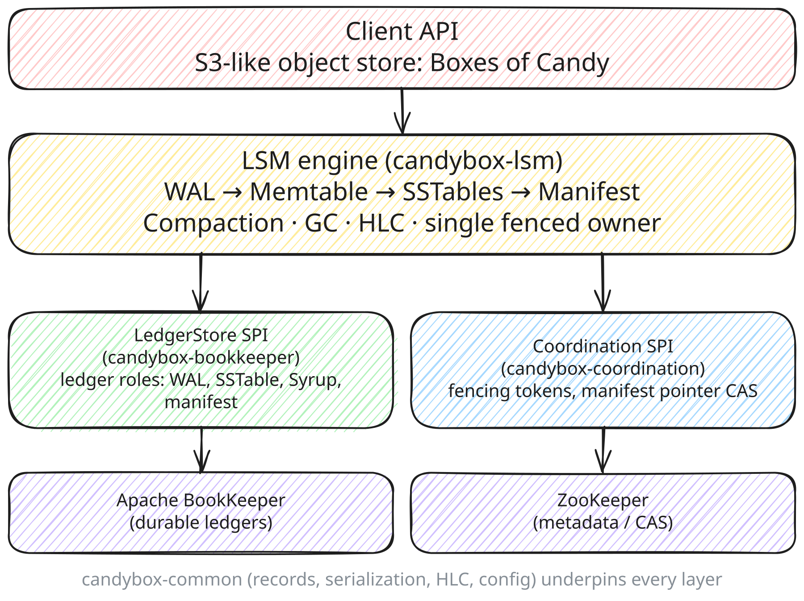
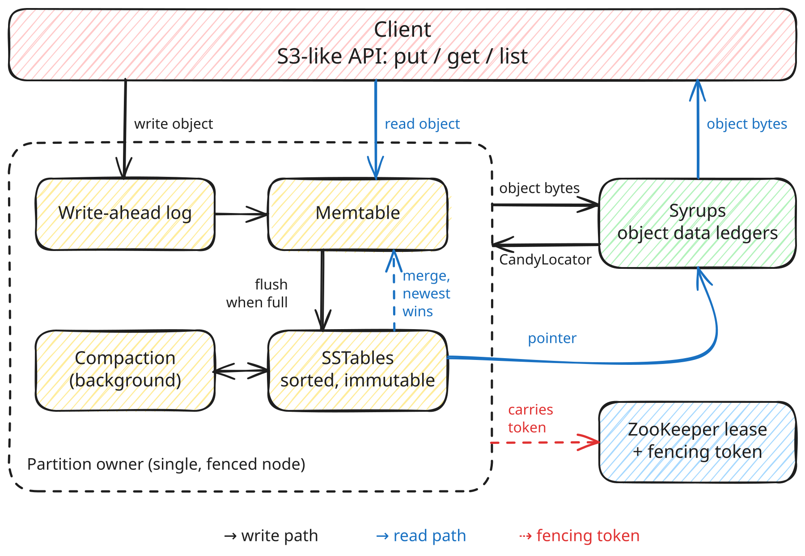
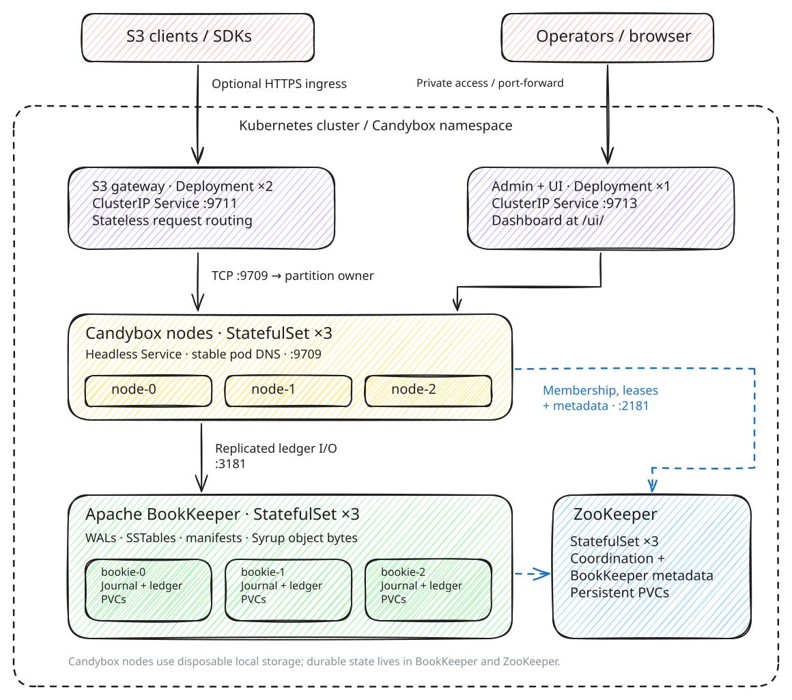

# Concepts & architecture

Candybox is layered top to bottom: an S3-like object API sits on a per-Box LSM engine, which talks to
two narrow SPIs, which in turn run on Apache BookKeeper (durable ledgers) and ZooKeeper
(coordination/metadata).

`candybox-common` (shared records, `BinaryWriter`/`BinaryReader` serialization, HLC, config) underpins
every layer. Object bytes never enter the LSM tree: candy lives in Syrups and the tree holds only
`CandyLocator` pointers.

## How it works

Candybox blends three well-known designs.

- **A LevelDB-style LSM tree** for the index. Writes land in an in-memory *memtable* fronted by a
  write-ahead log; when it fills, it is flushed to an immutable, sorted **SSTable** and later merged
  into larger ones by background **compaction**. Reads merge the memtable and SSTables, newest wins.

- **Object data kept out of the tree.** Object bytes are written to dedicated data ledgers
  (*Syrups*); the LSM tree stores only a small **pointer** to where each object lives. This keeps the
  index tiny and compaction cheap no matter how large the objects are.

- **BookKeeper ledgers as the durable medium.** Every SSTable, WAL, manifest, and Syrup is a
  BookKeeper ledger — append-only, replicated, and self-fencing. Candybox never mutates data in
  place; updates and deletes are new appends (with tombstones), Apache-Pulsar-style.

## Typical Kubernetes deployment

The [Candybox Helm chart](https://github.com/predatorray/candybox/blob/main/candybox-charts/README.md)
deploys the application services and, optionally, BookKeeper and ZooKeeper in a Kubernetes namespace.
The diagram shows the chart's persistent, replicated baseline.

### Request routing

Two stateless S3 gateway replicas serve S3 requests through a ClusterIP Service on port `9711`.
A separate admin deployment serves the JSON API and web dashboard at `/ui/` through a ClusterIP
Service on port `9713`. Both use Candybox's client to route requests to the node that owns the
relevant partition over TCP on port `9709`.

The three Candybox nodes run as a StatefulSet. A headless Service provides stable per-pod DNS names
for the addresses advertised in cluster membership; requests can therefore reach individual
partition owners. ZooKeeper tracks membership and ownership leases, and the elected balancer
distributes partitions across the nodes.

### Durable storage

Candybox nodes keep their durable state in the backends, so their local logs and temporary files
use disposable storage. The three BookKeeper bookies run as a StatefulSet with separate journal
and ledger PVCs per bookie. They persist the WALs, SSTables, manifests, and Syrup object bytes in
replicated ledgers. Three ZooKeeper replicas use persistent volumes for Candybox coordination and
BookKeeper metadata.

The chart also runs BookKeeper AutoRecovery, omitted from the diagram, to repair under-replicated
ledgers when sufficient bookies are available. The
[production example](https://github.com/predatorray/candybox/blob/main/candybox-charts/candybox-chart/values-production.yaml)
uses four bookies so a failed bookie can be replaced in a three-member ensemble, and adds
application authentication and workload placement settings. The single-node demo instead uses
ephemeral storage and does not provide this replicated topology.

### Access and deployment options

Services remain cluster-internal by default. An optional ingress can expose the S3 gateway with
HTTPS termination; the admin dashboard can be reached through port-forwarding or a private
authenticated proxy. Direct Java or CLI clients need network access to ZooKeeper and the advertised
node addresses. The chart can also connect to operator-managed BookKeeper and ZooKeeper clusters
instead of deploying its own backends.

See [Running on Kubernetes]() for deployment
options and the chart's installation and production configuration instructions.

## Fenced ownership

Consistency rests on **single, fenced ownership per partition**: every Box is split into a fixed
number of hash partitions, and at any moment exactly one node owns a partition, holding a ZooKeeper
lease with a *fencing token*. Every state-changing operation carries that token, so if ownership moves
during a failure, a stale former owner can no longer corrupt the partition. An elected balancer
spreads partition ownership evenly across the cluster, so one Box's writes are served by many nodes.
Each write is stamped with a hybrid logical clock for last-writer-wins ordering across nodes.

## Operations the sorted LSM tree makes cheap

Because keys are stored sorted and object bytes live behind small pointers, Candybox offers a few
operations an S3-style store cannot do cheaply:

- **Bounded / reverse range scans** walk a `[start, end)` window in either direction, paging with
  `--start-after`.
- **Zero-copy `copy` / `rename`** point a new key at the *same* stored bytes — no data is moved, even
  across hash partitions (the stored bytes are shared cluster-wide). A same-partition `rename` removes
  the source atomically; a cross-partition `rename` is *eventually* atomic, converging to "source gone,
  destination present".
- **`delete-range`** deletes a whole prefix or key window with a single range tombstone (constant work
  regardless of how many keys it covers); the bytes are reclaimed lazily by compaction.

See the [command-line client]() for how to invoke them.

## Deeper design docs

The authoritative design write-ups live in the repository and go well beyond this overview:

- [`DESIGN.md`](https://github.com/predatorray/candybox/blob/main/DESIGN.md) — record formats and the
  fencing / handover protocol.
- [`BOX_PARTITIONING_PLAN.md`](https://github.com/predatorray/candybox/blob/main/BOX_PARTITIONING_PLAN.md)
  — partitioning.
- [`MULTIPART_RANGE_PLAN.md`](https://github.com/predatorray/candybox/blob/main/MULTIPART_RANGE_PLAN.md)
  — range GET and multipart upload.
- [`S3_GATEWAY_PLAN.md`](https://github.com/predatorray/candybox/blob/main/S3_GATEWAY_PLAN.md) and
  [`AUTH_PLAN.md`](https://github.com/predatorray/candybox/blob/main/AUTH_PLAN.md) — the S3 gateway and auth.

## Module layout

| Module | Responsibility |
|---|---|
| `candybox-common` | Domain types, versioned serialization, configuration, CRC32C, bloom filter. |
| `candybox-bookkeeper` | The `LedgerStore` abstraction over BookKeeper — the only module that touches the raw BookKeeper client — with an in-memory fake. |
| `candybox-coordination` | Membership, fenced leases, and CAS key-value over ZooKeeper, with an in-memory fake. |
| `candybox-lsm` | The LSM engine: memtable, WAL, SSTables, Syrup chunking, manifest, merge/read path, compaction. |
| `candybox-protocol` | The framed TCP wire protocol and transport. |
| `candybox-server` | The storage node: wires the engine behind the protocol, plus the runnable entrypoint, health/metrics, and ownership. |
| `candybox-client` | The thin client library and the `candybox` command-line tool. |
| `candybox-s3-gateway` | A path-style, S3-compatible HTTP gateway (Netty) with optional SigV4 auth + S3 ACL enforcement. Stateless. |
| `candybox-admin-api` | A stateless HTTP service exposing cluster / boxes / LSM / metrics as JSON, plus the static SPA mount. |
| `candybox-web` | React + TypeScript + MUI dashboard, packaged into a jar so the admin API serves it from the classpath. |
| `candybox-dist` | Packages the runnable distribution (`bin/ lib/ conf/`) and the Docker/Kubernetes assets. |
| `candybox-integration-tests` | End-to-end tests on embedded BookKeeper + ZooKeeper. |
